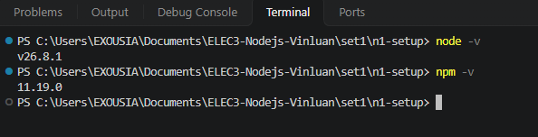
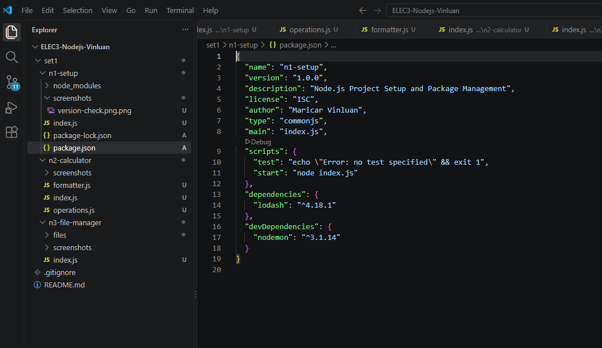
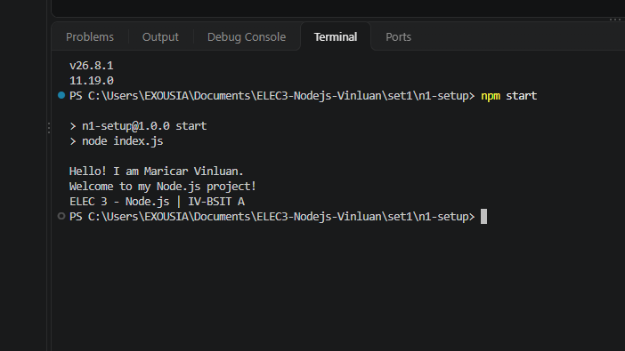
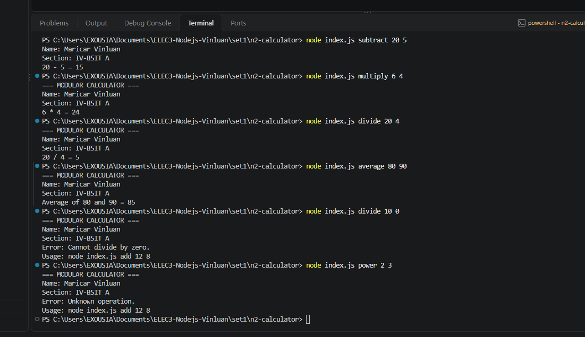
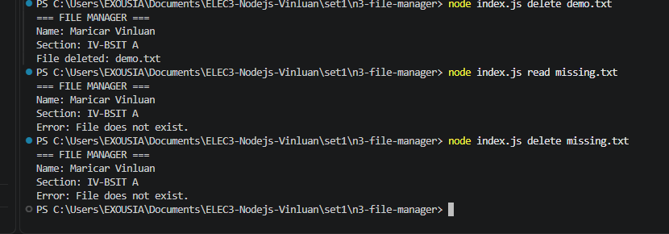

# ELEC3-Nodejs-Vinluan

## Student Information

- **Name:** Maricar Untalan Vinluan
- **Section:** IV-BSIT A
- **Course:** ELEC 3 – Node.js
- **Activity Set:** Set 1

## About the Repository

This repository contains my self-paced learning activities in ELEC 3 – Node.js. These activities cover project setup, package management, modular programming, and file management using Node.js.

## Set 1 Activities

| Activity | Description | Folder |
|---|---|---|
| N1 | Project Setup and Package Management | [View Activity](set1/n1-setup) |
| N2 | Modular Calculator | [View Activity](set1/n2-calculator) |
| N3 | File Manager | [View Activity](set1/n3-file-manager) |

## Requirements

- Node.js
- npm
- Git
- Visual Studio Code or another code editor

## N1 – Project Setup and Package Management

This activity demonstrates how to initialize a Node.js project, install regular and development dependencies, and configure an npm start script.

### How to Run

From the repository root:

```bash
cd set1/n1-setup
npm install
npm start
```

### Written Answers

[View N1 Written Answers](set1/n1-setup/N1.ANSWERS.ELEC3.docx)

### Screenshots

**Node.js and npm Version Check**



**Package Configuration**



**Program Output**



## N2 – Modular Calculator

This activity demonstrates modular programming using separate JavaScript files for mathematical operations and result formatting. It also uses command-line arguments and error handling.

### How to Run

From the repository root:

```bash
cd set1/n2-calculator
node index.js add 12 8
node index.js subtract 12 8
node index.js multiply 12 8
node index.js divide 12 8
node index.js average 12 8
```

### Error Handling

```bash
node index.js divide 12 0
node index.js unknown 12 8
```

### Screenshots

**Calculator Operations**



**Error Handling**


## N3 – File Manager

This activity demonstrates file management using the built-in fs and path modules of Node.js. The program allows users to create, read, update, delete, and list text files.

### How to Run

From the repository root:

```bash
cd set1/n3-file-manager
node index.js create demo.txt "Hello Node.js"
node index.js read demo.txt
node index.js update demo.txt "Learning file management"
node index.js list
node index.js delete demo.txt
```

### Error Handling

```bash
node index.js read missing.txt
node index.js delete missing.txt
```

### Screenshots

**File Operations and Listing**


**Error Handling**



## Learning Outcomes

Through these activities, I learned how to:

- Initialize and manage a Node.js project.
- Install regular and development dependencies.
- Create and use custom JavaScript modules.
- Process command-line arguments.
- Perform mathematical operations and handle errors.
- Manage files using the fs and path modules.
- Use Git and GitHub for version control.

## Author

Maricar Untalan Vinluan  
IV-BSIT A  
ELEC 3 – Node.js